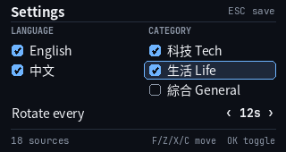

# News for CardputerZero

Rotating news headlines on the M5Stack CardputerZero's 320x170 screen. One headline at a time in large type, with a scrolling ticker of the next ones. Sources are public RSS feeds (no API key), refreshed every 15 minutes and cached for offline viewing.

 

## Sources

Press S to choose languages (English, Chinese) and categories (Tech, Life, General). Each combination has its own feeds:

| | English | Chinese |
|---|---|---|
| Tech | Hacker News, The Verge, Ars Technica, Engadget | unwire.hk, iThome, 科技新報, INSIDE |
| Life | BBC Health, NYT Well / Food / Travel, CBC Arts | 明報娛樂, RTHK 體育, 中央社 生活 / 文化, 自由時報 生活 |
| General | BBC World, CBC News, CBC Toronto, NYT | RTHK 本地 / 國際, 星島, BBC 中文 |

The default is both languages, Tech only, rotating every 12 seconds.

 

## Keys

As the CardputerZero key spec recommends, plain F / Z / X / C work as arrow keys.

| Screen | Key | Action |
|--------|-----|--------|
| Main | F / X (or Fn+F / Fn+X) | Previous / next headline |
| Main | OK (ENTER) | Full summary |
| Main | P / SPACE | Pause rotation |
| Main | R | Refresh now |
| Main | S | Settings |
| Main | ESC / Q | Exit |
| Details | F / X | Scroll |
| Details | ESC / OK | Back |
| Settings | F / Z / X / C | Move up / left / down / right (Z / C change the rotation speed) |
| Settings | OK / SPACE | Toggle |
| Settings | ESC | Save and back |

## Install

From the CardputerZero AppStore, or build the package yourself on the device:

```sh
sh build-deb.sh "Your Name <you@example.com>"
sudo dpkg -i zero-news_1.0.0_all.deb
```

For development, copy this folder to `~/zero-news` on the device and run `sudo sh ~/zero-news/install.sh` to register it with the launcher.

Requires `python3`, `python3-pil` and `python3-numpy`. Text uses the Noto Sans CJK font that ships with the CardputerZero launcher (bold headlines when `fonts-noto-cjk` is also installed, as it is on stock devices).

## Configuration

Settings are stored in `~/.config/zero-news.json`:

```json
{"languages": ["en", "zh"], "categories": ["tech"], "interval": 12}
```

To use your own feeds instead of the built-in list, add a `feeds` array. Entries with `lang` (`en` / `zh`) and `cat` (`tech` / `life` / `general`) follow the settings; entries without them are always shown:

```json
{"feeds": [{"name": "My Blog", "short": "Blog", "url": "https://example.com/feed.xml", "lang": "en", "cat": "tech"}]}
```

Fetched headlines are cached in `~/.local/share/zero-news/news.json`.

## Development

```sh
python3 -m unittest test_zero_news
python3 zero_news.py --fetch                    # fetch and print the headlines
python3 zero_news.py --preview out.png --fetch  # render preview frames to PNG
```

## License

MIT
